# Aawaz: Safe Reporting and Evidence Vault

> **Private Harassment Reporting That Links Repeat Offenders**  
> *"You are heard. You are not alone."*

---

## Overview

Workplace sexual harassment is rarely an isolated incident; it is usually an ongoing pattern protected by silence, power asymmetry, and fear of single retaliation. Many survivors hesitate to report out of concern for professional fallout, disbelief, or "he said, she said" dismissals.

**Aawaz** provides a privacy-first sanctuary designed under the **POSH Act 2013** and **DPDPA 2023**:

- **Client-Side Zero-Knowledge Encryption**: Reports and uploaded exhibits are encrypted directly in the browser. Unconsented narratives and personal identities never leak.
- **Dynamic Blind Cryptographic Matching**: Reports are indexed using Keyed HMAC-SHA256 and phonetic normalization (Metaphone/Soundex) to pair independent complaints without exposing plaintext names. No static mocks, benchmark numbers, or fake profiles.
- **Two-Party Consent Ladder**: When two independent individuals report the same respondent, neither identity or narrative is revealed until both mutually consent to advance through progressive verification stages.
- **Direct & Joint Escalation**: Survivors can jointly compile a tamper-evident complaint or file directly to their organization's Internal Grievance Committee (IGC / IC).

---

## Safety & Privacy Architecture

- **Study Notes Disguise**: A discreet cover view masquerading as student notes (*"Computer Science & Data Structures Notes"*) accessible instantly via PIN lock.
- **Instant Quick Exit**: A persistent escape button in the top navigation bar that immediately masks the screen and switches to Google.
- **No PII Credentials Required**: No email address, phone number, or login credentials needed. Accounts are generated as anonymous vault IDs (e.g., `Velvet-Harbor-804`).
- **One-Click Vault Restoration**: Quickly restore or switch between local vault accounts without complex recovery phrases.

---

## System Workflow Diagram

```mermaid
flowchart LR
    subgraph Intake["1. Documentation"]
        direction TB
        A[Survivor Documents Incident] --> B[5-Step Incident Builder]
        B --> C[Phonetic Sound Key and Blind HMAC]
    end

    subgraph Routing["2. Routing"]
        direction TB
        C --> D{Escalation Route}
    end

    subgraph DirectRoute["Direct Channel"]
        direction TB
        D -->|Immediate Filing| F[Direct Complaint Inbox]
    end

    subgraph MatchingRoute["3. Mutual Consent Ladder"]
        direction TB
        D -->|Pattern Match Route| E[Dynamic Vault Engine]
        E --> G[2nd Independent Report Filed]
        G --> H["Step 1: Pattern Found (Zero narrative shared)"]
        H --> I["Step 2: Mutual Consent (Timelines unlocked)"]
        I --> J["Step 3: Joint Legal Complaint (Joint PDF and send)"]
    end

    subgraph IC["4. Internal Committee Review"]
        direction TB
        F --> M[IC Reviewer Console]
        J -->|Joint PDF or Push| M
        M --> N[Evidence Verification]
        N --> O[Section 12 Interim Relief and Inquiry]
    end
```



---

## Core Features & Workflow

### 1. Guided 5-Step Incident Builder
- **Step 1: Narrative Recording** — Express what happened via text or voice transcription.
- **Step 2: AI Chronology Structuring** — Converts free-form narratives into structured events with dates, locations, witnesses, and behavior tags.
- **Step 3: Respondent Indexing** — Enter the accused individual's name and organisation to generate real-time phonetic sound keys and blind HMAC match tokens.
- **Step 4: Evidence Locker with Visual & Audio Support** — Attach screenshots, documents, audio recordings, or video clips. Images are embedded visually in official complaints, and multimedia files are SHA-256 fingerprinted.
- **Step 5: Client-Side Seal** — Final review and client-side sealing.

### 2. Two-Sided Step-by-Step Escalation Hub
Information unlocks only when **both individuals mutually consent**:
- **Step 1: Pattern Discovery** — Notifies both parties that another independent filing exists regarding the same respondent without sharing names or timelines.
- **Step 2: Chronology Verification** — Mutual request-and-agree protocol unlocks incident dates and behavioral categories to corroborate patterns.
- **Step 3: Joint Legal Complaint** — Unlocks the formal joint complaint package. Both complainants can download the generated single-page legal PDF or directly dispatch the case to the IC Reviewer with one click.
- **No Static Demos or Benchmarks** — Dynamic, two-sided interactions between real vaults without artificial simulation buttons or fixed counter badges.

### 3. Direct IC Complaint Channel
- Complainants who choose not to wait for a pattern match can escalate their report directly to the Internal Committee from the Dashboard.
- Files appear in the IC Reviewer portal under a dedicated **Direct Complaints** inbox for prompt administrative review.

### 4. Certified IC Reviewer Portal
- **Role-Based PIN Terminal**: Secure portal for certified Presiding Officers and IC caseworkers.
- **Pending Matches Evaluation**: Evaluates high-confidence HMAC pattern clusters with survivor safeguards.
- **Direct Complaints Queue**: Review individual filings, acknowledge receipts, or dismiss non-actionable items.
- **Multimedia Evidence Inspection**: Direct in-browser previews for screenshots and inline playback for audio and video exhibits.
- **Audit Logging**: Non-PII immutable audit logs compliant with Section 16 of the POSH Act and DPDPA 2023.

### 5. Know Your Rights & Multimedia Presentation
- **POSH Act 2013 Guide**: Clear breakdown of Internal Committee composition, filing timelines (Section 9), interim relief (Section 12), and statutory confidentiality (Section 16).
- **Expandable Steps Accordion**: 6-step breakdown of filing procedures presented in an accessible dark-maroon accordion.
- **Synchronized Audio-Visual Presentation**: Features an embedded official audio narration and timed motion graphics detailing survivor rights and evidence integrity under Section 65B of the Indian Evidence Act.
- **Emergency Helplines**: Quick access to national women helplines (1091 / 181), NCW Harassment Cell, and Cyber Crime portals.

### 6. Single-Page Legal Evidence PDF Export
- Generates a compact, professional legal complaint addressed to the **Internal Grievance Committee (IGC)**.
- Formatted without consumer app branding to comply with formal legal submission standards.
- Includes complainant pseudonyms, respondent details, structured incident chronology (up to 3 concise exhibits), digital exhibits with SHA-256 checksums, and Section 12 interim relief requests.

---

## Project Structure

```
Aawaz/
├── client/                          # React + TypeScript + Vite Frontend
│   ├── public/                      # Static assets and media (aawaz_presentation.mp3)
│   ├── src/
│   │   ├── components/              # UI views & components
│   │   │   ├── Dashboard.tsx        # Vault overview, reports list & direct IC filing
│   │   │   ├── ReportBuilder.tsx    # 5-step incident form with multimedia support
│   │   │   ├── MatchesHub.tsx       # Dynamic two-party consent ladder & joint complaint
│   │   │   ├── ReviewerConsole.tsx  # IC portal with matches, direct inbox & audit logs
│   │   │   ├── RightsExplainer.tsx  # POSH Act legal guide with steps accordion & video
│   │   │   ├── AuthorityVideoModal.tsx # Synchronized audio-visual presentation modal
│   │   │   ├── DisguiseOverlay.tsx  # Study Notes cover screen
│   │   │   └── Navbar.tsx           # App navigation with notification bell & quick exit
│   │   ├── context/
│   │   │   └── AppContext.tsx       # State management: vaultStore, direct complaints & matching
│   │   ├── utils/
│   │   │   ├── crypto.ts            # Client-side AES-256-GCM & SHA-256 fingerprinting
│   │   │   ├── hasher.ts            # Keyed HMAC-SHA256 & phonetic normalization
│   │   │   ├── aiStructuring.ts     # Chronological parsing & category tagging
│   │   │   ├── pdfGenerator.ts      # jsPDF formal legal complaint generator
│   │   │   └── translations.ts      # Multilingual text mappings
│   │   ├── types/
│   │   │   └── index.ts             # TypeScript definitions (ReportDraft, MatchRecord, DirectComplaint)
│   │   ├── App.tsx                  # App layout, router & redesigned dark footer
│   │   └── main.tsx                 # Root entrypoint
│   ├── package.json
│   └── vite.config.ts
│
└── server/                          # Optional Python / FastAPI backend microservice
    ├── main.py                      # FastAPI HMAC matching endpoints
    ├── requirements.txt
    └── test_matching.py
```

---

## Tech Stack & Architectural Layers

```
┌─────────────────────────────────────────────────────────────────────────────┐
│                              FRONTEND LAYER                                 │
│  React 18 (SPA)  │  Vite (Bundler)  │  TypeScript (Strict)  │  Tailwind CSS │
├─────────────────────────────────────────────────────────────────────────────┤
│                          STATE & MULTI-VAULT STORE                          │
│  React Context API  │  Multi-User Account Switcher  │  Local Encrypted Data │
├─────────────────────────────────────────────────────────────────────────────┤
│                         CRYPTOGRAPHY & FORENSICS                            │
│  Web Crypto API (Subtle)  │  AES-256-GCM (Payloads)  │  PBKDF2 (Derivation) │
│  Keyed HMAC-SHA256 (Tokens)  │  SHA-256 Fingerprinting (Section 65B Audits) │
├─────────────────────────────────────────────────────────────────────────────┤
│                            MATCHING ENGINE                                  │
│     Double Metaphone (Phonetic)  │  Soundex Keys  │  Zero-Knowledge Matrix  │
├─────────────────────────────────────────────────────────────────────────────┤
│                        DOCUMENT & MULTIMEDIA SUITE                          │
│  jsPDF (1-Page Legal Evidence)  │  Base64 Embedded Images  │  HTML5 Audio   │
├─────────────────────────────────────────────────────────────────────────────┤
│                          BACKEND MICROSERVICE (OPTIONAL)                    │
│      FastAPI (Python 3.10+)  │  Uvicorn  │  Server-Side Blind HMAC Index    │
└─────────────────────────────────────────────────────────────────────────────┘
```

| Layer | Technologies & Tools | Implementation Purpose |
|---|---|---|
| **User Interface & Styling** | React 18, Vite, TypeScript, Tailwind CSS | Single-page application with type-safe components, high-speed HMR, and responsive sanctuary styling (soft blush, glassmorphism, dark maroon legal surfaces). |
| **Client-Side Cryptography** | Native Web Crypto API (`window.crypto.subtle`) | Zero-knowledge client-side encryption. Generates AES-256-GCM sealed blobs, PBKDF2 derived keys, and blind HMAC-SHA256 match hashes directly on-device without third-party key leaks. |
| **Phonetic Matching Engine** | Double Metaphone, Soundex Algorithms | Normalizes names and company tokens into sound keys (e.g., `VRN_SHRM`), catching spelling variations, abbreviations, and typos across independent filings. |
| **Forensic Evidence & Document Export** | jsPDF, HTML5 Canvas, FileReader API | Converts screenshots to embedded base64 graphics, applies SHA-256 integrity checksums (Indian Evidence Act Sec. 65B), and outputs clean, 1-page formal complaints. |
| **State & Identity Management** | React Context API, Local Multi-Vault System | Manages dynamic peer identities, simultaneous two-sided multi-user test sessions, and stage-by-stage consent handshakes without hardcoded profiles or demo buttons. |
| **Multimedia & Presentation** | Web Audio API, HTML5 Audio Player | Synchronized audio-visual presentation with embedded voiceover (`/aawaz_presentation.mp3`) and inline playback in the IC Reviewer console. |
| **Backend Service (Optional)** | Python 3, FastAPI, Uvicorn | Standalone microservice for blind HMAC token indexing and enterprise multi-tenant server deployment. |

---

## Getting Started

### Prerequisites
- Node.js (v18 or higher)
- npm or pnpm

### Installation

```bash
# Clone the repository and enter the client directory
cd client

# Install dependencies
npm install

# Start the development server
npm run dev
```

Open **`http://localhost:3000`** in your browser.

---

## Security & Statutory Disclaimer

Aawaz provides report organization, cryptographic matching, and statutory guidance. It does not replace formal legal counsel. All platform operations adhere to the non-disclosure mandates of **Section 16 of the POSH Act 2013** and data minimization principles under the **Digital Personal Data Protection Act (DPDPA) 2023**.

---

## License

This project is open-source under the **MIT License**.
